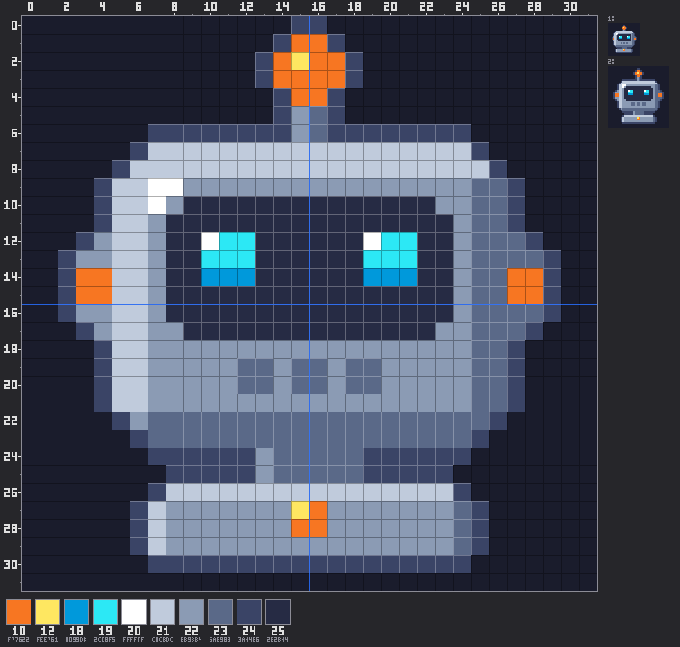
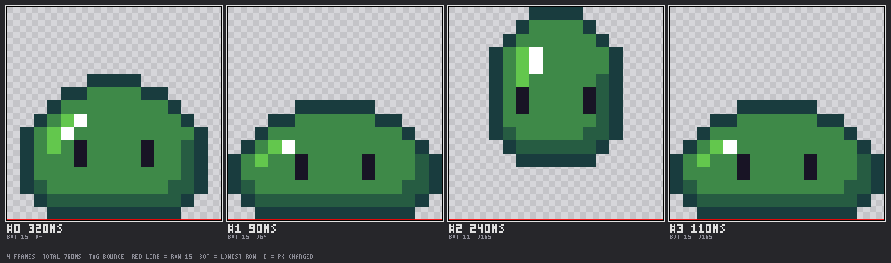

<p align="center">
  
</p>

<h1 align="center">PixelClaus</h1>

<p align="center">
  <b>A pixel-art and sprite-animation editor built for Claude to drive over MCP.</b><br>
  Sprites, animations, tiles and sprite sheets, drawn by an AI agent through 24 tools.
</p>

<p align="center">
  <a href="https://github.com/vidux/pixelclaus/actions/workflows/ci.yml"></a>
  <a href="LICENSE"></a>
  
  
</p>

---

PixelClaus gives Claude (or any [Model Context Protocol](https://modelcontextprotocol.io) client) a real
pixel-art editor: layers, frames, tags, palettes with ramps, batched drawing ops, previews it can look at,
exact pixel readback, lint for pixel-art mistakes, and export to PNG, GIF, APNG, WebP, sprite sheets and
`.aseprite`. A small web viewer lets you watch the projects, play the animations and download the files.

## Gallery

Every image below was drawn by an agent through PixelClaus tool calls: no image editor and no
hand-placed pixels outside the tools. The calls are in [examples/showcase.ts](examples/showcase.ts);
`npm run showcase` draws them again.

<table>
  <tr>
    <td align="center"></td>
    <td align="center">
      
      
      
    </td>
    <td align="center"></td>
  </tr>
  <tr>
    <td align="center"><b>Robot</b> · 32×32<br>idle: 1 px bob, antenna glow, blink; 4 frames</td>
    <td align="center"><b>Slime</b> · 16×16<br>squash &amp; stretch; three skins from one export (palette swap)</td>
    <td align="center"><b>Coin</b> · 16×16<br>built from <code>ellipse</code> + <code>shade</code> ops, no grids</td>
  </tr>
  <tr>
    <td colspan="3" align="center">
      <br>
      <b>Items</b> · three 16×16 icons, one per frame, exported as a sprite sheet
    </td>
  </tr>
</table>

### What the agent sees

Claude can't watch an animation play or zoom with a mouse, so the tools give it pictures and numbers
made for an agent. On the left, the `render` composite view: the sprite with a pixel grid, 0-indexed
rulers, 1× and 2× insets and the palette strip with indices. Below it, the `filmstrip` view of the slime
shows every frame with its duration and lowest row.

<p align="center">
  
</p>
<p align="center">
  
</p>

With the pictures come numbers it can act on. Here is part of `analyze {kind:"lint"}` on the robot:

```text
- [info] orphan-pixels f0: 4 interior pixel(s) whose colour appears in none of the 8 neighbours (noise / pillow artefacts) at (15,2) (10,12) (19,12) (15,27)
  hint: Keep only deliberate highlights; otherwise merge into a neighbouring colour cluster
```

(The four "orphans" are deliberate glints on the antenna, the eyes and the chest light, so they stay.
An earlier draft also got a "doubles" warning at the ears; rounding their corners fixed it.)

## Features

- **A full sprite document.** Indexed or RGBA colour, layers with groups, blend modes, opacity and
  reference layers, frames with their own durations, linked cels, tags (forward, reverse, ping-pong,
  repeat), slices with 9-patch and pivot, named selections, and palettes with named colours and ramps.
- **Drawing made for an agent.** One `draw` call applies up to 2000 ops as one atomic, undoable step.
  The ops: ASCII `grid`, pixels, lines, paths, rectangles, ellipses, circles, polygons, fill, dithered
  gradients, patterns, outline and selout, ramp shading, stamp between frames, text, colour adjustments
  and quantize. Symmetry and ink modes (behind, alpha lock, blend) work with all of them.
- **Feedback the agent can use.**
  - Views: composite, silhouette, value, indexed, onion skin, diff, 3×3 tile, filmstrip, motion trail,
    timing, contact sheet and palette.
  - `read_pixels` gives an exact ASCII readback that you can paste straight back into `grid`.
  - `analyze` reports stats, colour usage, 22 lint rules, per-frame animation metrics, and frame diffs
    with the best-fit shift.
- **Safe to experiment.** Undo/redo, plus named checkpoints that are saved to disk.
- **Formats.**
  - Export: PNG, JPG, WebP, GIF, APNG, animated WebP and PNG frame sequences. Sprite sheets come in 5
    layouts with Aseprite or TexturePacker JSON. Also `.aseprite`, native `.pxc` backups, and palettes
    (`.hex`, `.gpl`, `.pal`, `.act`).
  - Import: images, animated images, sprite sheets, `.aseprite`, `.pxc` and palettes.
- **24 palette presets.** PICO-8, Endesga 32, DB16/32, Resurrect 64, AAP-64, NES, Game Boy and more,
  plus hue-shifted ramp generation and palette-swap exports.
- **Many agents at once.** Parallel subagents or several sessions can share one server. Heavy work runs
  on worker threads, so one agent's export never blocks another agent's preview.
- **Web viewer.** A project grid, a pixel-perfect animation player, layers, details, export and delete.

## Installation

You need **Node.js 22.12 or newer** (the current LTS is fine) and npm 10 or newer. PixelClaus runs on
Windows, macOS and Linux.

```bash
git clone https://github.com/vidux/pixelclaus.git
cd pixelclaus
npm install
npm run build
```

Check that it works:

```bash
node packages/server/dist/cli.js info    # prints the resolved configuration as JSON
npm test                                 # optional: the full test suite (~630 tests)
```

`npm install` also downloads [sharp](https://sharp.pixelplumbing.com) (image decoding) as a prebuilt
binary for your platform. If that fails behind a proxy, see sharp's
[installation notes](https://sharp.pixelplumbing.com/install).

## Connect it to Claude

All of these use the built CLI at `packages/server/dist/cli.js`. Use the **absolute path** to your
clone.

### Claude Code

```bash
claude mcp add pixelclaus -- node /absolute/path/to/pixelclaus/packages/server/dist/cli.js mcp --viewer
```

Start a new session and run `/mcp`: `pixelclaus` should be listed as connected.

### Claude Desktop

Open **Settings → Developer → Edit config** and add the server to `claude_desktop_config.json`:

```json
{
  "mcpServers": {
    "pixelclaus": {
      "command": "node",
      "args": ["/absolute/path/to/pixelclaus/packages/server/dist/cli.js", "mcp", "--viewer"]
    }
  }
}
```

On Windows, escape the backslashes in the path:
`"C:\\Users\\you\\pixelclaus\\packages\\server\\dist\\cli.js"`. Restart Claude Desktop afterwards.

### Any MCP client over HTTP

Run one server that every client (and the viewer) shares:

```bash
npm start      # = pixelclaus serve: viewer + REST API + MCP at http://127.0.0.1:7420/mcp
claude mcp add --transport http pixelclaus http://127.0.0.1:7420/mcp
```

Other MCP clients connect the same way: either the stdio command `node …/cli.js mcp`, or the
Streamable HTTP endpoint `http://127.0.0.1:7420/mcp`.

## Usage guide

### 1. Ask for art in plain words

Once the server is connected, just describe what you want. The agent picks the tools. Some prompts that
work well:

> Draw a 32×32 knight with the endesga-32 palette, light from the top left. Then make a 4-frame walk
> cycle, check it with lint, and export a GIF at 4× plus a sprite sheet with Aseprite JSON.

> Make a 16×16 grass tile that tiles seamlessly. Show me the 3×3 tile view before exporting.

> Import /path/to/hero.png as a new project, reduce it to the pico-8 palette and export it as .aseprite.

> Give the slime three colour variants with a palette swap and export each one as a GIF.

Tips:

- **Name a size and a palette.** Small canvases (16×16, 32×32) and a preset palette give the best
  results.
- **Ask for checks.** "Run lint and fix what it finds" and "show me the value view" make the agent
  review its own work.
- **Animations:** say how many frames and what kind of motion (idle, walk, attack). The built-in guides
  give the agent timing rules for each.
- **Undo is cheap.** Ask for a checkpoint before big changes ("checkpoint, then try a darker outline").

### 2. Watch and download in the viewer

With `--viewer` (or `npm start`), open <http://127.0.0.1:7420>. You can see the projects update while
the agent works, play animations by tag, toggle layers, and download any export format. See
[docs/viewer.md](docs/viewer.md).

### 3. Find your files

Projects live in the data directory: `~/.pixelclaus` by default, or set `PIXELCLAUS_DATA`. Exports go to
`<data>/projects/<id>/exports/` unless you ask for another folder, e.g. "export it to
/path/to/game/assets/sprites". The agent then passes `outputDir`. Use absolute paths: `~` is only expanded
in `PIXELCLAUS_DATA`. In `serve` mode, import and export paths must stay inside the data directory.

### 4. What a session looks like

These are the calls behind the robot in the gallery, shortened. `tool` names the tool, and the other
fields are its arguments (the full version is in [examples/showcase.ts](examples/showcase.ts)):

```jsonc
// 1. a 32×32 project with one layer
{ "tool": "project_create", "name": "robot", "width": 32, "height": 32,
  "palette": "endesga-32", "layers": ["Robot"], "settings": { "lightDirection": "top-left" } }

// 2. flats as an ASCII grid (legend → palette index), then a 1 px outline around the silhouette
{ "tool": "draw", "project": "robot", "ops": [
  { "op": "grid", "rows": ["...............BB...............", "…32 rows…"],
    "legend": { "L": 21, "M": 22, "D": 23, "V": 25, "E": 19, "B": 10 } },
  { "op": "outline", "side": "outside", "color": 24 } ] }

// 3. look at it, check it
{ "tool": "render", "project": "robot", "view": "value" }
{ "tool": "analyze", "project": "robot", "kind": "lint" }

// 4. animate: copy the frame 3×, bob frame 1 down 1 px, light the antenna on frame 2, blink on frame 3
{ "tool": "frame", "project": "robot", "action": "duplicate", "frame": 0, "count": 3 }
{ "tool": "cel", "project": "robot", "action": "move", "layer": "Robot", "frames": [1], "dy": 1 }
{ "tool": "draw", "project": "robot", "ops": [
  { "op": "grid", "frame": 2, "x": 14, "y": 1, "rows": ["~YY~", "YWYY", "YYYY", "~YY~"], "legend": { "Y": 12, "W": 20 } },
  { "op": "grid", "frame": 3, "x": 10, "y": 12, "rows": ["VVV~~~~~~VVV", "EEE~~~~~~EEE", "VVV~~~~~~VVV"],
    "legend": { "V": 25, "E": 19 } } ] }
{ "tool": "frame", "project": "robot", "action": "duration", "frames": "all", "durations": [500, 350, 700, 120] }
{ "tool": "tag", "project": "robot", "action": "add", "name": "idle", "from": 0, "to": 3 }

// 5. export
{ "tool": "export", "project": "robot", "format": "gif", "tag": "idle", "scale": 6 }
```

In a grid, `.` is transparent and `~` leaves a pixel unchanged, so the blink is a 12×3 patch over the eyes.
Every tool and parameter is listed in [docs/mcp-tools.md](docs/mcp-tools.md).

### 5. Built-in guides

The agent can read guides on demand: the `guide` tool, the `pixelclaus://guide/{topic}` resources, and
three prompts (`sprite_workflow`, `animation_workflow`, `tileset_workflow`). Topics: overview, ascii,
sprite, animation, tileset, palettes, lint, export, ops. The same text is in [docs/guides/](docs/guides/README.md).

### 6. Use it from your own code

Any MCP client library can drive the server. [examples/showcase.ts](examples/showcase.ts) uses the
official TypeScript SDK to start `pixelclaus mcp` over stdio, draw, render, lint and export:

```bash
npm run build
npm run showcase -- out/ previews/   # images to out/, the agent's render views to previews/
```

[examples/social-banner.ts](examples/social-banner.ts) builds a whole animated scene the same way:
[examples/social-banner.gif](examples/social-banner.gif), a framed 1080×1080 social banner that loops every 3 s
(30 frames, 1.4 MB), drawn on 16 layers with 55 tool calls. `npm run banner` draws it again. Both
scripts share an MCP client and the sprite art in [examples/lib/](examples/lib/).

## CLI and configuration

```text
pixelclaus mcp   [--data DIR] [--viewer] [--port N] [--restrict-paths]   MCP over stdio (+ optional viewer)
pixelclaus serve [--data DIR] [--host H] [--port N] [--no-mcp]          HTTP: viewer + REST API + MCP at /mcp
pixelclaus info  [--data DIR] [--port N] [--restrict-paths]             print the resolved configuration
```

From a clone, run `node packages/server/dist/cli.js <command>`. `npm start` and `npm run mcp` are
shortcuts for `serve` and `mcp`.

| Environment variable | Default | Meaning |
| --- | --- | --- |
| `PIXELCLAUS_DATA` | `~/.pixelclaus` | data directory (projects in `<data>/projects/<id>/`) |
| `PIXELCLAUS_HOST` / `PIXELCLAUS_PORT` | `127.0.0.1` / `7420` | HTTP bind address |
| `PIXELCLAUS_ALLOW_ANY_PATH` | `true` | `mcp`: allow import/export paths outside the data dir (`serve` always restricts them) |
| `PIXELCLAUS_CACHE` | `32` | projects kept in memory (idle ones beyond this are unloaded) |
| `PIXELCLAUS_CACHE_IDLE` | `600` | seconds a project must be idle before it may be unloaded (unloading clears its undo) |
| `PIXELCLAUS_HISTORY` | `300` | undo steps per project |
| `PIXELCLAUS_THREADS` | CPUs − 1 (2–8) | compute worker threads for previews, exports and analysis (`0` = main thread) |

`serve` listens on `127.0.0.1` only. Use `--host 0.0.0.0` only on a trusted network: there is no
authentication, and DNS-rebinding protection allows only loopback `Host` headers unless you configure
others.

## Many agents at once

One server can serve several agents building different assets at the same time: parallel Claude Code
subagents on one stdio server, or several sessions over HTTP.

- **Projects don't block each other.** Previews, exports and analysis run on a pool of worker threads.
  Previews jump ahead of queued exports, and one worker is always kept free for them.
- **One project per agent.** Names are unique. If seven agents create "Hero" at the same moment, one
  gets it and the others get a CONFLICT error with a free name. `ifExists:"suffix"` gives automatic
  ids (`hero-2`) instead.
- **Several processes.** Several sessions may each start their own `pixelclaus mcp` on the same data
  directory. Ids stay unique, and edits to one project are serialised with a lock file.
- **Same project.** Calls on one project run one at a time, in order. Undo history is per project.

Measure it on your machine (7 agents × 128×128 × 16 frames, while a probe agent keeps making small
calls):

```bash
npm run build && npm run bench:agents -- 7 128 16
```

## Troubleshooting

| Problem | Fix |
| --- | --- |
| The tools don't show up in Claude | Check that the path is absolute and that `npm run build` has run. `node <path>/cli.js info` must print JSON. Restart the client. |
| `Cannot find module …/dist/cli.js` | Run `npm run build`. The `dist/` folders are not in git. |
| Viewer page doesn't load | Another program may be using port 7420: add `--port 7421` (or set `PIXELCLAUS_PORT`). The server log (stderr) says whether the viewer started. |
| `Path … is outside the PixelClaus data directory` | You're in `serve` mode (or used `--restrict-paths`). Use a path inside `PIXELCLAUS_DATA`, or use `mcp` mode. |
| sharp fails to install | See [sharp's install guide](https://sharp.pixelplumbing.com/install). A clean `npm install` usually fixes it. |

## Documentation

| Document | Contents |
| --- | --- |
| [docs/mcp-tools.md](docs/mcp-tools.md) | Every tool, parameter, draw op, resource and prompt (generated: `npm run docs`) |
| [docs/guides/](docs/guides/README.md) | The in-tool guides: overview, ascii, sprite, animation, tileset, palettes, lint, export, ops |
| [docs/architecture.md](docs/architecture.md) | Packages, document model, transactions, storage, MCP design |
| [docs/formats.md](docs/formats.md) | Export/import formats and options |
| [docs/viewer.md](docs/viewer.md) | Viewer usage and the REST API |
| [docs/design/spec.md](docs/design/spec.md) | Design spec |
| [docs/devlog.md](docs/devlog.md) | Development log |
| [CLAUDE.md](CLAUDE.md) | Conventions for working on this repository |

## Development

```text
packages/core      @pixelclaus/core     engine: model, history, drawing, render, analysis (no deps, no Node APIs)
packages/formats   @pixelclaus/formats  PNG/APNG/GIF codecs, .aseprite, sprite sheets, palettes, .pxc (browser-safe)
packages/server    @pixelclaus/server   storage, services, MCP tools, REST API, CLI (Node)
packages/viewer    @pixelclaus/viewer   web viewer (Vite, vanilla TypeScript)
examples/                               scripts that drive the MCP server (the README gallery)
docs/                                   documentation, guides, design spec, devlog
```

```bash
npm run build        # TypeScript packages + viewer (the CLI tests need this once)
npm test             # vitest: unit, integration and QA suites
npm run lint         # ESLint (keeps core/formats browser-safe)
npm run typecheck    # tsc -b + viewer
npm run format       # Prettier
npm run docs         # regenerate docs/mcp-tools.md and docs/guides/ after changing tools
npm run dev          # HTTP server from sources (tsx)
npm run dev:viewer   # Vite dev server for the viewer (proxies /api to :7420)
```

Contributions are welcome. Please run `npm run lint`, `npm run typecheck` and `npm test` before opening
a pull request, and read [CLAUDE.md](CLAUDE.md) for the code conventions.

### Working with Claude Code

The repo ships project skills and agents in [.claude/](.claude/). Claude Code loads them when you open
the folder:

| | Use it for |
| --- | --- |
| [`add-feature`](.claude/skills/add-feature/SKILL.md) | which files to touch for a new tool, draw op, lint rule, export format or compute task |
| [`pixel-art-workflow`](.claude/skills/pixel-art-workflow/SKILL.md) | drawing and animating with the tools; regenerating the gallery |
| [`windows-portability`](.claude/skills/windows-portability/SKILL.md) | tests that fail only on Windows; filesystem-safe code |
| [`release-check`](.claude/skills/release-check/SKILL.md) | everything to run before a PR or release, including a Markdown link checker |
| `pixel-art-advisor` agent | a read-only pixel-art expert for reviewing features and art |
| `qa-tester` agent | exercises features and adds tests under `packages/*/test/qa/` |
| `/devlog` command | appends an entry to [docs/devlog.md](docs/devlog.md) |

## License

[MIT](LICENSE) © 2026 Viduranga
